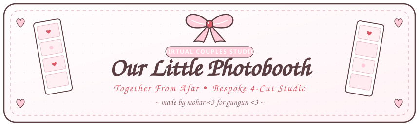

<p align="center">
  <a href="https://mohargorai.github.io/couples-photobooth/">
    
  </a>
</p>

<p align="center">
  <a href="https://mohargorai.github.io/couples-photobooth/">
    
  </a>
  
  
  
  
  
</p>

<p align="center">
  <em>made by mohar with love for gungun &lt;3</em>
</p>

<p align="center">
  ୨୧ ─────────────────────────────────────────────────────────── ୨୧
</p>

## The Story Behind This Project

**Our Little Photobooth** is an interactive, handcrafted virtual couples photobooth designed to capture classic 4-cut photobooth memory strips together, no matter how many miles lie in between.

Built as a personal romantic keepsake by **Mohar** for **Gungun**, the application recreates the nostalgic charm of vintage Korean and Japanese sticker photobooths right inside the browser. It combines real-time peer-to-peer video streaming with an artisanal "Soft Coquette &amp; Hand-Drawn" visual world: warm milk cream paper textures, delicate gingham checks, dainty ribbon bows, and sweet handwritten love notes.

<p align="center">
  ୨୧ ─────────────────────────────────────────────────────────── ୨୧
</p>

## Design Philosophy &amp; Color Palette

This project follows a strict **anti-AI-slop, zero-emoji aesthetic philosophy**:
- **Zero Raw Unicode Emojis:** You will not find standard system emojis anywhere in the interface or documentation. Every icon, decorative motif, and sticker is custom-coded as an organic hand-sketched SVG vector with soft irregular strokes.
- **Strictly No Pure Black (`#000000`):** All linework and typography use Warm Cocoa Brown (`#5A3E42`) to evoke the feel of fountain pen ink or soft colored pencil on cotton stationery.
- **Handmade Coquette Harmony:** A balanced palette of creamy neutrals, blushing rose tones, and soft berry accents.

### Palette System

| Color Name | Hex Code | Visual Sample | Application &amp; Role |
| :--- | :--- | :--- | :--- |
| **Milky Cream** | `#FFF9FB` | `[ #FFF9FB ]` | Base canvas background, warm off-white studio paper |
| **Soft Alabaster** | `#FFFFFF` | `[ #FFFFFF ]` | Photo cards, pristine clean highlights, high-contrast badges |
| **Baby Pink** | `#FFD1DC` | `[ #FFD1DC ]` | Coquette ribbon loops, header badges, pastel gingham check |
| **Pastel Rose** | `#F8BBD0` | `[ #F8BBD0 ]` | Soft control pills, border accents, secondary blush |
| **Soft Berry Red** | `#D85A67` | `[ #D85A67 ]` | Doodled hearts, shutter highlights, countdown timer |
| **Warm Cocoa** | `#5A3E42` | `[ #5A3E42 ]` | Hand-drawn pencil strokes, primary typography, film border |

<p align="center">
  ୨୧ ─────────────────────────────────────────────────────────── ୨୧
</p>

## Key Features

### 1. Solo &amp; Live "Together Room" (WebRTC Co-Op)
- **Zero-Backend Peer-to-Peer:** Powered directly by WebRTC media streams and PeerJS data channels without storing private photos on an external database.
- **Instant Romantic Room Links:** Generates shareable invite links with room keys (e.g. `?room=rose-4892`) with one-tap link copying and ribbon toast feedback.
- **Dual Live Viewfinder:** Host camera on the left, partner camera on the right with independent hardware controls and unified framing.
- **Synchronized Countdown &amp; Shutter:** Initiating capture triggers an exact synchronized countdown (`3... 2... 1... *flash*`) across both devices, capturing 4 sequential memories simultaneously.
- **Real-Time Studio Mirroring:** Frame choices, sticker additions, handwritten captions, and ink selections sync live across both screens.

### 2. Camera Hardware &amp; Orientation Suite
- **Smart Camera Lifecycle &amp; Privacy Toggle:** Dedicated **Cam On / Off** toolbar toggle completely stops active hardware video tracks (`track.stop()`) and unbinds `srcObject = null` to immediately turn off physical webcam lights and mobile green privacy dots. Automatically shuts down the camera when switching to "2. Decorate Strip", clicking "&lt;- Letter", or minimizing the browser (`visibilitychange`), showing a cozy "Camera is resting" White Rose card with one-tap wake up.
- **Camera Device Enumerator:** Switch seamlessly between built-in webcams, USB cameras, OBS Virtual Camera, or front/back smartphone sensors without page reloads.
- **Multi-Axis Alignment:**
  - `Mirror X`: Flip horizontally for a natural selfie-mirror reflection.
  - `Flip Y`: Invert vertically for upside-down webcam or ceiling tripod setups.
  - `Rotate 90°`: 4-step clockwise rotation (`0° / 90° / 180° / 270°`) for landscape cameras mounted in portrait orientation.
- **Aspect &amp; Zoom Controls:** Smooth 0.5x to 1.4x digital zoom slider, reset buttons, and sensor aspect toggle (`Fit Full` vs `Fill Fit`).
- **100% Canvas Transformation Sync:** Live CSS preview transformations are mapped 1:1 onto HTML5 Canvas matrices (`ctx.translate`, `ctx.rotate`, `ctx.scale`) so the printed strip exactly mirrors what was seen on screen.

### 3. Coquette Customization Studio
- **8 Handcrafted Border Frames:**
  1. *Milky Cream Classic:* Warm off-white card with organic paper borders.
  2. *Baby Pink Gingham:* Handcrafted picnic gingham checkered weave.
  3. *Soft Berry Polka Dot:* Milky base peppered with dainty hand-drawn dots.
  4. *Coquette Scalloped Lace:* Scalloped eyelet lace trim along photo edges.
  5. *Satin Ribbon Weave:* Interlacing pink ribbon strips with corner rosettes.
  6. *Vintage Air-Mail Letter:* Red and soft pink diagonal envelope stripes.
  7. *Blush Watercolor Wash:* Soft-edged pastel rose and cream atmospheric wash.
  8. *Warm Cocoa Film Strip:* Retro dark-cocoa photobooth negative with cream lettering.
- **16 Custom Hand-Drawn SVG Stickers:**
  - Includes dainty ribbon bows, blooming white roses, coquette rose stems with bows, twin rosebuds with baby's breath, doodled twin hearts, wax seals, paper airplanes, cherries, strawberries, locket amulets, and sealed envelopes.
  - Floating 28px antenna rotate stem, independent drag/scale anchors, dynamic counter-scaling for finger taps, and drop shadows for visibility on both dark and light frames.
  - 4 One-Tap Layout Presets: *Bow Overload*, *Love Letter Set*, *Soft &amp; Minimal* (featuring corner white roses &amp; bows), and *Clear Canvas*.
- **Romantic Typography &amp; Inks:**
  - 3 romantic script typefaces (`Caveat`, `Sacramento`, `Indie Flower`).
  - 3 signature ink wells: Warm Cocoa (`#5A3E42`), Soft Berry (`#D85A67`), and Dusty Rose (`#C47A87`).
  - Romantic caption pills plus custom text entry with an automatic subtle date stamp.

### 4. 4-Cut Pose Inspiration &amp; Sample Strip Guide
- Curated romantic pose prompts for couples:
  - *Cut 1: Cheek Heart* — Curve your hand gently against your cheek.
  - *Cut 2: Wink &amp; Peace* — A classic playful pose with soft smiles.
  - *Cut 3: Flower Blossom* — Cup your face in your palms like petals.
  - *Cut 4: Cozy Lean* — Lean your heads together warmly.
- **Sample Photos Button:** Instantly test frames and stickers with 4 hand-sketched couple illustration cuts.

### 5. High-DPI Strip Dispenser &amp; Mobile Camera Roll Export
- Photorealistic animated dispenser slot: strips slide smoothly out of the virtual machine as pictures are taken.
- Multi-layer canvas compositor renders at 2x device pixel ratio (`1200 x 3600` canvas output).
- Native mobile Web Share API integration on iOS and Android for saving straight to the system Camera Roll, with high-resolution PNG download fallback.

<p align="center">
  ୨୧ ─────────────────────────────────────────────────────────── ୨୧
</p>

## How to Use "Together Mode"

```
Step 1: Open Studio      ───>  Click "Create Together Room" to get your romantic link.
Step 2: Send Invite       ───>  Send the link (?room=...) to your partner via WhatsApp or DM.
Step 3: Align Cameras     ───>  Adjust Mirror, Rotation, and Zoom until both frames look perfect.
Step 4: Take Photos!      ───>  Hit "Take Our Photos Together" for the synchronized 4-cut shoot.
```

1. **Create the Room:** Click **Create Together Room** in the studio navigation. A unique romantic room ID is generated and the URL updates automatically.
2. **Share the Link:** Click **Copy Invite Link** to copy the room URL with a dainty ribbon toast confirmation. Send it to your partner.
3. **Adjust Your Cameras:** When your partner connects, both live streams will appear side-by-side. Use the camera flip, 90° rotation, and zoom tools to align both perspectives.
4. **Capture &amp; Decorate:** Hit **Take Our Photos Together**. The synchronized 3-second countdown fires simultaneously on both devices. After the 4th cut, decorate your strip together in real time and save your high-resolution keepsake.

<p align="center">
  ୨୧ ─────────────────────────────────────────────────────────── ୨୧
</p>

## Local Development &amp; Deployment

### Local Development

Because WebRTC and camera access require a secure origin (`localhost` or `https://`), run the project using a lightweight local HTTP server:

```bash
# Clone the repository
git clone https://github.com/mohargorai/couples-photobooth.git
cd couples-photobooth

# Start the local development server (Node.js)
node server.js
```

Open **[http://localhost:3000](http://localhost:3000)** in your browser.

Alternatively, use any static web server:
```bash
# Using Python
python -m http.server 3000

# Using npx serve
npx serve .
```

### Running QA Verification Passes

The repository includes an automated verification suite that audits camera synchronization, SVG sticker bounds, and WebRTC signaling contracts:

```bash
node test_qa_passes.js
```

### Deployment

To use mobile devices or share the room link across the internet, the application must be served over **HTTPS** so browsers grant camera permissions:

**GitHub Pages (Active):**
   - Head to **Settings &gt; Pages** on GitHub.
   - Set Source to `Deploy from a branch` and select `main / (root)`.
   - Your site is live at **[https://mohargorai.github.io/couples-photobooth/](https://mohargorai.github.io/couples-photobooth/)**.

<p align="center">
  ୨୧ ─────────────────────────────────────────────────────────── ୨୧
</p>

<p align="center">
  <strong><a href="https://mohargorai.github.io/couples-photobooth/">Couples Photobooth</a></strong><br>
  <em>A romantic little photobooth, made with all my love for Gungun.</em><br>
  <em>made by mohar with love for gungun &lt;3</em>
</p>
